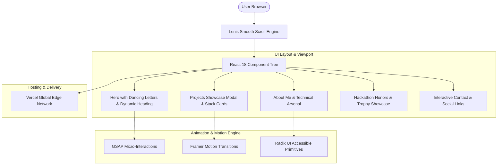

# 🌐 Shrikar's Interactive Portfolio

<div align="center">

[](https://portfolio-webiste-ruddy.vercel.app/)
[](https://react.dev/)
[](https://vitejs.dev/)
[](https://tailwindcss.com/)
[](https://www.framer.com/motion/)

A high-performance, visually immersive developer portfolio featuring custom micro-interactions, smooth physics-based scrolling, dynamic letter animations, and interactive project cards.

[Explore Live Demo →](https://portfolio-webiste-ruddy.vercel.app/)

</div>

---

## 🏗️ Architecture & Interaction Flow



---

## ✨ Key Features

- **Kinetic Typography**: Custom `dancing-letters` canvas and text physics engine that reacts to cursor position.
- **Lenis Smooth Scrolling**: Decoupled momentum scrolling for 60 FPS buttery-smooth navigation across sections.
- **Interactive Project Modal**: Filterable project showcases with live architecture highlights and demo links.
- **Responsive & Accessible**: Fully responsive grid built with Tailwind CSS and Radix UI accessible headless primitives.
- **Edge Optimized**: Sub-second initial page load with Vite 5 code splitting and asset pre-fetching.

---

## 🛠️ Tech Stack

- **Framework**: [React 18](https://react.dev/) + [Vite 5](https://vitejs.dev/)
- **Styling**: [Tailwind CSS](https://tailwindcss.com/) + PostCSS
- **Animation**: [Framer Motion](https://www.framer.com/motion/), [GSAP](https://greensock.com/gsap/)
- **Smooth Scroll**: [@studio-freight/lenis](https://github.com/darkroomengineering/lenis)
- **Icons**: [Lucide React](https://lucide.dev/)
- **Deployment**: [Vercel](https://vercel.com/)

---

## 🚀 Getting Started Locally

### Prerequisites
- Node.js 18+
- npm or pnpm

### Installation
```bash
# Clone repository
git clone https://github.com/shrikargs7-cloud/portfolio-webiste.git
cd portfolio-webiste

# Install dependencies
npm install

# Start local development server
npm run dev
```

### Production Build
```bash
npm run build
npm run preview
```

---

## 📄 License
MIT License © [Shrikar G S](https://github.com/shrikargs7-cloud)
